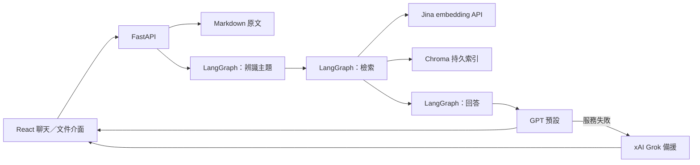

# HR Agent — 公司文件助理

以虛構香港公司 **Harbour Finch Labs｜港雀科技** 為背景，展示繁體中文聊天、文件問答、可點擊的來源引用及 Markdown 原文閱讀。此版本不提供入職任務、員工資料或會面管理。

## 功能及架構



- **GPT 優先、xAI 備援**：GPT 正常時不呼叫 xAI；逾時、認證／額度／服務故障時切換。預設冷卻 60 秒，之後由下一個問題探測 GPT 是否恢復；沒有背景探測。
- **API embedding**：使用 `jina-embeddings-v4`，文件／問題採用不同 retrieval task，2048 維正規化向量。不安裝或下載 E5、PyTorch、SentenceTransformers。
- **文件原文獨立可用**：即使模型 API 故障，也可開啟文件清單和閱讀原文。
- **無 PostgreSQL**：只需前端、後端和一個保存 Chroma 的持久資料目錄。
- **主題辨識與分項搜尋**：LangGraph 使用「辨識主題 → 檢索 → 回答」。從四份文件的 40 個章節辨識中英文主題，多主題時分項搜尋，避免年假等資料被其他福利片段擠走；見 [主題清單與規則](docs/TOPICS.md)。
- **減少模型呼叫**：主題辨識不呼叫 LLM；多條搜尋文字在同一次 embedding 請求處理，再由一次聊天呼叫回答。快取命中可省下 embedding。
- **同一分頁保存聊天**：開關文件不會清除歷史及草稿；重新整理或關閉分頁後不保存。「清除對話」只修改瀏覽器狀態。

完整行為與驗收條件見 [規格](docs/specs/chat-document-demo.md)。

## 環境設定

首次設定才複製範本，已有 `.env` 請直接編輯，避免覆蓋 Key：

```powershell
Copy-Item .env.example .env
```

```dotenv
# 原本 GPT 代理；填入該代理的 Key
OPENAI_API_KEY=
OPENAI_BASE_URL=https://share.transmd.cloud/v1
OPENAI_MODEL=gpt-6.1-sol
OPENAI_ACTOR_AUTHORIZATION=local-image-extension

# xAI 備援；必須與 GPT Key 分開
XAI_API_KEY=
XAI_BASE_URL=https://api.x.ai/v1
XAI_MODEL=grok-4.3

# Jina 文件搜尋
EMBEDDING_API_KEY=
EMBEDDING_BASE_URL=https://api.jina.ai/v1
EMBEDDING_MODEL=jina-embeddings-v4
EMBEDDING_DIMENSIONS=2048
```

兩個聊天供應商均使用 Responses API，`store=False`。改用 OpenAI 官方 API 時需自行設定該帳戶可用的模型、`https://api.openai.com/v1` 及其 Key，並清空代理專屬標頭。Key 只放後端，不使用 `VITE_` 前綴，不提交 `.env`。同名變數只留一份。

Jina v4 官方免費 API 只適用研究及非商業用途，有限流及延遲限制；本專案是非商業 Demo。未設定 Key 時仍能啟動及閱讀文件，相應聊天／搜尋功能會顯示設定錯誤。GPT 安全拒絕不會被當成故障繞到另一供應商。

## 本機啟動（Windows／PowerShell）

需要 Python 3.10+（Docker 使用 3.11）及目前支援的 Node.js LTS，不需要 Docker、PostgreSQL 或 GPU。從專案根目錄執行：

```powershell
python -m venv .venv
.\.venv\Scripts\python.exe -m pip install -r backend/requirements.txt
$env:PYTHONPATH = "$PWD;$PWD/backend"
.\.venv\Scripts\python.exe -m uvicorn app.main:app --app-dir backend --host 127.0.0.1 --port 8000
```

另一個 PowerShell：

```powershell
cd frontend
npm.cmd ci
npm.cmd run dev
```

開啟 [聊天及文件](http://localhost:5173)、[API 文件](http://localhost:8000/docs)。程式自動讀取專案 `.env`；已存在的程序環境變數優先。修改 `.env` 後重新啟動後端。

如果原有 `.venv` 曾安裝 E5，它的舊套件不會被 pip 自動移除；新建乾淨環境即可避免攜帶這些套件。舊模型快取及 PostgreSQL 資料不會被本版刪除或使用。

## Docker Compose

```powershell
docker compose up --build -d
docker compose logs -f backend
docker compose down
```

預設只啟動前端（5173）及後端（8000）。`./data` 掛載到 `/app/data`，保存索引；沒有資料庫、pgAdmin 或 MCP 啟動依賴。Docker 是可選的啟動方式。

## 文件與索引更新

白名單在 `shared/documents.py`，閱讀清單與搜尋共用四份 UTF-8 Markdown：

| 文件 | 內容 |
| --- | --- |
| `employee-handbook.md` | 年假、出糧、工時、試用期及行為守則 |
| `benefits-guide.md` | 醫療、強積金、產假、侍產假及開支報銷 |
| `it-setup.md` | 電腦、VPN、Slack、權限及資訊保安 |
| `onboarding-checklist.md` | 首 30 天入職安排 |

首次搜尋建立 Jina 索引，之後重啟直接重用。每次搜尋比對文件內容雜湊；新增／修改只重新計算變更區塊，刪除文件則移除相應區塊。改模型、維度或切塊規則會重建新 collection，成功後才切換 manifest，避免半成品或過期政策被使用。舊 E5 collection 不會被重用或自動刪除。

索引及 manifest 位於 `data/chroma/`。新增文件時須同時更新白名單／顯示標題；目前沒有 PDF、Word 或上傳功能。模型沒有找到政策時必須說明資料不足。

畫面及答案使用「僱員手冊」等中文名稱，原有 `.md` 檔名只作內部識別。多主題搜尋每項最多兩個區塊、合計最多六個；單一或未辨識主題保留原問題 top-3 語意搜尋。未命中搜尋片段不能當作整份文件沒有記載的證據。

## 測試與評估

不呼叫外部 API 的測試：

```powershell
.\.venv\Scripts\python.exe -m pip install pytest
.\.venv\Scripts\python.exe -m pytest tests -q
cd frontend
npm.cmd test
npm.cmd run build
npm.cmd run lint
```

真實 Jina 測試需有效 Key，會使用 API 額度，並在臨時目錄建索引：

```powershell
$env:RUN_API_INTEGRATION = "1"
.\.venv\Scripts\python.exe -m pytest tests/test_rag_integration.py -q
Remove-Item Env:RUN_API_INTEGRATION
```

Golden／DeepEval 是開發者工具，結果保存於 `evals/results/`，沒有公開管理頁，也不會在一般啟動時自動執行。操作見 [EVALS](docs/EVALS.md)。

## 部署及用量

- 前端可單獨部署；設定 `VITE_API_URL` 為後端 HTTPS 網址。後端 `CORS_ORIGINS` 填前端來源，逗號分隔。
- 後端支援 `PORT`，以單一 worker／副本運行。掛載一個持久磁碟到 `/app/data`，設定 `DATA_DIR=/app/data`。索引不能放在部署後會清空的檔案系統而又預期永久保存。
- 前端沒有定時輪詢，後端沒有模型探測、資料庫心跳或本地模型下載；平台休眠後由下一個請求喚醒。
- 用 Railway 的 Usage／Metrics／服務狀態查看費用及休眠。定時打 `/health` 會喚醒服務，不能用它被動觀察休眠。
- Railway 資源費與各 API 費分開計算；是否符合免費額度須用實際部署數據確認。
- 日誌記錄供應商、備援原因、耗時及可取得的 token 用量，不輸出 Key 或全文對話。

備份或搬機時保留程式、`seed-data/`、私下保存的 `.env` 及可選的 `data/chroma/`。索引遺失可重新產生，但需要再次呼叫 Jina；本版沒有需要遷移的 PostgreSQL 業務資料。

## 專案結構

`backend/` 提供 FastAPI、LangGraph 及備援；`shared/` 提供文件及 RAG；`frontend/` 提供 React 介面；`tests/` 是離線回歸及可選 API 測試。舊 `shared/tasks.py`、`shared/db.py` 及 `mcp-server/` 屬歷史工作流程工具，不在本版 Web 啟動路徑；獨立使用它們仍需其原有資料庫及依賴。
