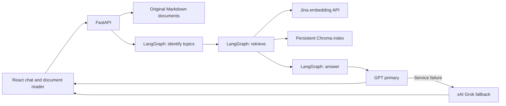

# HR Agent — Company Document Assistant

**English** | [繁體中文](README.zh-Hant.md)

A chat and document-reading demo for the fictional Hong Kong company **Harbour Finch Labs｜港雀科技**. Ask questions about company policies, inspect cited sources, and read the original Markdown documents. The interface uses Traditional Chinese; the assistant can answer English questions in English. This version does not manage onboarding tasks, employee records, or meetings.

## Features and architecture



- **GPT primary, xAI fallback:** successful GPT requests never call xAI. Eligible timeout, authentication, quota, or service failures trigger fallback. After a default 60-second cooldown, the next question probes GPT recovery; there is no background polling. Safety refusals do not trigger fallback.
- **API embeddings:** `jina-embeddings-v4` uses separate passage/query retrieval tasks and normalized 2048-dimensional vectors. No E5, PyTorch, or SentenceTransformers downloads.
- **Independent document reader:** source documents remain readable when model APIs fail.
- **No PostgreSQL dependency:** the web demo needs a frontend, backend, and persistent directory for Chroma.
- **Topic-aware retrieval:** local bilingual rules recognize topics from 40 sections across four documents. Compound questions retrieve each recognized topic separately. See [topics and limitations](docs/TOPICS.md) (Traditional Chinese).
- **Fewer model calls:** topic identification needs no LLM. Missing query vectors are embedded in one batch, followed by one chat call under normal conditions. Query-cache hits avoid embedding calls.
- **In-tab conversation state:** opening documents preserves messages and drafts. Refreshing or closing the tab clears them; “Clear conversation” only changes browser state.

See the [implementation specification](docs/specs/chat-document-demo.md) (Traditional Chinese) for detailed behavior and acceptance criteria.

## Environment setup

Copy the template only on first setup. If `.env` already exists, edit it without overwriting your keys:

```powershell
Copy-Item .env.example .env
```

```dotenv
# Separate xAI fallback credentials
XAI_API_KEY=
XAI_BASE_URL=https://api.x.ai/v1
XAI_MODEL=grok-4.3

# Jina document retrieval
EMBEDDING_API_KEY=
EMBEDDING_BASE_URL=https://api.jina.ai/v1
EMBEDDING_MODEL=jina-embeddings-v4
EMBEDDING_DIMENSIONS=2048
```

Configure the primary chat provider using the variables documented in `.env.example`. Both chat providers use the Responses API with `store=False`. Keep keys on the backend, never prefix them with `VITE_`, and never commit `.env`. Define each variable once.

This is a non-commercial demo. Check Jina's current terms and limits before other uses; its v4 free API is intended for research/non-commercial use and may have rate or latency limits. Missing keys do not prevent startup or direct document reading; affected chat/search operations return configuration errors.

## Run locally (Windows / PowerShell)

Use Python 3.10+ (the Docker image uses 3.11) and a supported Node.js LTS release. Docker, PostgreSQL, and a GPU are not required. From the repository root:

```powershell
python -m venv .venv
.\.venv\Scripts\python.exe -m pip install -r backend/requirements.txt
$env:PYTHONPATH = "$PWD;$PWD/backend"
.\.venv\Scripts\python.exe -m uvicorn app.main:app --app-dir backend --host 127.0.0.1 --port 8000
```

In another PowerShell window:

```powershell
cd frontend
npm.cmd ci
npm.cmd run dev
```

Open the [chat and document reader](http://localhost:5173) or [API documentation](http://localhost:8000/docs). The backend loads the root `.env`; existing process environment variables take precedence. Restart the backend after changing `.env`.

If an old virtual environment contains E5 dependencies, create a clean environment: installing the new requirements does not uninstall old packages. Existing model caches and PostgreSQL data are neither deleted nor used by this web version.

## Docker Compose

```powershell
docker compose up --build -d
docker compose logs -f backend
docker compose down
```

Compose starts only the frontend (5173) and backend (8000). It mounts `./data` at `/app/data` to preserve the index. There are no database, pgAdmin, or MCP startup dependencies. Docker is optional.

## Documents and index updates

The reader and search share four allowlisted UTF-8 Markdown files, configured in `shared/documents.py`:

| File | Contents |
| --- | --- |
| `employee-handbook.md` | Leave, payroll, working hours, probation, and conduct |
| `benefits-guide.md` | Medical insurance, MPF, maternity/paternity leave, and expenses |
| `it-setup.md` | Computers, VPN, Slack, access, and information security |
| `onboarding-checklist.md` | The first 30 days of onboarding |

The first search builds the Jina index; later restarts reuse it. Content hashes identify changed documents, and only new or modified chunks need new passage embeddings. Removed content is dropped. Changing the model, dimensions, or chunking rules builds a new collection and publishes its manifest atomically after success. Legacy E5 collections are not reused or automatically deleted.

The index and manifest live in `data/chroma/`. Adding a document requires updating the allowlist and display title. PDF, Word, and file uploads are not supported.

The interface and answers show readable Chinese source titles such as “僱員手冊”; `.md` filenames remain internal identifiers. Multi-topic retrieval takes at most two chunks per topic and six overall. Single-topic or unrecognized questions retain the original top-3 vector search. Missing search extracts are not evidence that a policy is absent from the complete documents.

## Tests and evaluations

Offline checks, without external API calls:

```powershell
.\.venv\Scripts\python.exe -m pip install pytest
.\.venv\Scripts\python.exe -m pytest tests -q
cd frontend
npm.cmd test
npm.cmd run build
npm.cmd run lint
```

Real Jina integration tests require a valid key, consume API allowance, and build an index in a temporary directory. Run from the repository root:

```powershell
$env:RUN_API_INTEGRATION = "1"
.\.venv\Scripts\python.exe -m pytest tests/test_rag_integration.py -q
Remove-Item Env:RUN_API_INTEGRATION
```

To check live compound-topic retrieval and a chat answer:

```powershell
.\.venv\Scripts\python.exe scripts/smoke_topics.py --chat
```

Golden/DeepEval runs are developer tools, save results under `evals/results/`, and do not run at normal startup. There is no public evaluation admin page. See [evaluation instructions](docs/EVALS.md) and [validation results](docs/VALIDATION.md) (Traditional Chinese).

## Deployment and usage

- The frontend can be hosted separately. Set its build-time `VITE_API_URL` to the backend HTTPS URL and set backend `CORS_ORIGINS` to the allowed frontend origins, separated by commas.
- The backend supports `PORT`. Run a single worker/replica, mount persistent storage at `/app/data`, and set `DATA_DIR=/app/data`. Ephemeral deployment storage will not preserve the index across replacements.
- The frontend has no periodic polling; the backend has no model probes, database heartbeats, or local model downloads. On platforms configured to sleep, a subsequent request wakes the service.
- Use Railway's Usage, Metrics, and service status to inspect consumption and sleep behavior. Periodic `/health` requests can wake the service and are not passive sleep monitoring.
- Hosting and API charges are separate. Whether free credits cover the demo depends on actual deployment usage.
- Logs include provider, fallback reason, elapsed time, and available token usage, without keys or full conversations.

For backup or migration, retain the source, `seed-data/`, a private copy of `.env`, and optionally `data/chroma/`. A missing index can be regenerated with additional Jina calls. This web version has no PostgreSQL business data to migrate.

## Project layout

`backend/` contains FastAPI, LangGraph, and provider fallback; `shared/` contains documents and RAG; `frontend/` contains the React interface; and `tests/` contains offline regression and optional API tests. Legacy `shared/tasks.py`, `shared/db.py`, and `mcp-server/` belong to the historical workflow and are outside the current web startup path. Running them separately still requires their original dependencies and database.
