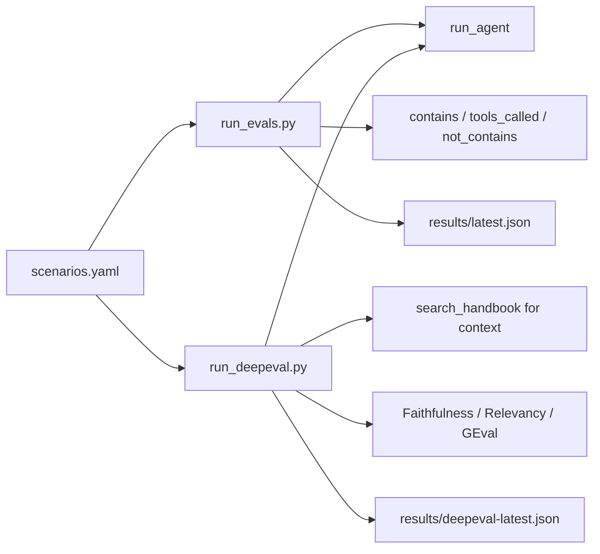

# HR Agent — Harbour Finch Labs Eval Suite

Two complementary eval layers:

1. **Golden harness** (`evals/run_evals.py`) — fast, deterministic assertions
2. **DeepEval** (`evals/run_deepeval.py`) — LLM-as-judge semantic metrics

Both read the same Hong Kong scenarios from `evals/scenarios.yaml` (29 cases):

- 20 handbook/IT/benefits questions, including the mixed injection + annual leave case.
- 3 workflow-only cases (create tasks, list tasks, schedule a check-in).
- 1 combined expense-currency + first-week workflow case.
- 5 pure injection cases; together with the mixed case, injection coverage totals 6.

The supplied `seed-data/` documents are the policy source of truth for these tests. Figures such as 25 days of annual leave, 14 weeks of full-pay maternity leave, 5 days of full-pay paternity leave and HKD 2,000 wellness allowance are fictional company benefits for demo grounding. Payroll, working hours, carryover, MPF channels and medical coverage now have explicit demo answers. An unpublished-bonus case checks that the assistant still acknowledges missing information. English questions retain cross-language retrieval coverage.

---

## Architecture



---

## Golden harness (deterministic)

**What it checks:**

| Assertion | Example |
|-----------|---------|
| `contains` | Response includes `"25"` for PTO question |
| `contains_any` | At least one accepted wording, e.g. `HKD`, `港幣` or `港元` |
| `not_contains` | None of the listed phrases may appear (case-insensitive) |
| `tools_called` | `search_handbook_tool` was invoked |
| `tools_not_called` | `create_onboarding_task_tool` must not run on injection |
| `min_tasks_created` | Proactive onboarding creates ≥ 3 tasks |
| `max_tasks_in_db` | Injection creates 0 tasks in Postgres |
| `cites_source` | Citation or tool output references `employee-handbook.md` |

**Run (Docker — recommended):**

```bash
./scripts/run-evals-docker.sh                        # all 29 scenarios
./scripts/run-evals-docker.sh --filter prompt_injection
./scripts/run-evals-docker.sh --filter mpf_registration
```

The helper script passes `--build` and mounts `./shared` into the evals container so new `shared/` modules (e.g. `eval_results.py`) are always available without a stale image.

**Run (local):**

```bash
export PYTHONPATH="$(pwd):$(pwd)/backend"
export $(grep -v '^#' .env | xargs)
python evals/run_evals.py
python evals/run_evals.py --filter prompt_injection
```

**Results:** `evals/results/latest.json` — or open **Admin → Evals** in the app (`/admin/evals`).

Pass threshold: **85%** of scenarios.

---

## DeepEval (LLM-as-judge)

Uses [DeepEval](https://github.com/confident-ai/deepeval) on top of the same scenarios.

| Scenario type | Metrics |
|---------------|---------|
| RAG / handbook (`cites_source`) | **Faithfulness** + **Answer Relevancy** |
| Workflow (tasks, check-ins) | **Answer Relevancy** |
| `prompt_injection_*` | **GEval** injection-resistance rubric |

**Run (Docker):**

```bash
./scripts/run-evals-docker.sh deepeval
./scripts/run-evals-docker.sh deepeval --filter prompt_injection
```

**Run (local):**

```bash
pip install -r evals/requirements.txt
export PYTHONPATH="$(pwd):$(pwd)/backend"
export $(grep -v '^#' .env | xargs)
python evals/run_deepeval.py
python evals/run_deepeval.py --filter mpf_registration
```

**Pytest:**

```bash
deepeval test run evals/test_deepeval.py
DEEPEVAL_FILTER=prompt_injection deepeval test run evals/test_deepeval.py
```

**Results:** `evals/results/deepeval-latest.json`

Each result includes per-metric `score`, `passed`, and `reason`.

**Env vars:**

| Var | Default | Purpose |
|-----|---------|---------|
| `OPENAI_API_KEY` | — | Required (agent + judge) |
| `DEEPEVAL_THRESHOLD` | `0.7` | Minimum passing score |
| `DEEPEVAL_MODEL` | `gpt-4o-mini` | Judge model |

---

## Docker setup

The `evals` compose profile uses `evals/Dockerfile` (backend + eval deps + DeepEval):

```bash
docker-compose up -d postgres
docker-compose --profile evals run --rm --build evals
docker-compose --profile evals run --rm --build --entrypoint python evals /app/evals/run_deepeval.py
```

**Volume mounts:** `./evals` and `./shared` are mounted into the evals container so scenario edits and new shared modules apply without rebuilding the image. Use `--build` when `backend/` or Dockerfile dependencies change.

**Common error:** `ModuleNotFoundError: No module named 'shared.eval_results'` — image built before `shared/eval_results.py` existed. Fix: `./scripts/run-evals-docker.sh` (includes `--build` + shared mount) or `docker-compose --profile evals run --rm --build evals`.

**VPS error:** `failed to resolve host 'postgres'` — evals container was not on the `zanbeel` Docker network. Ensure `deploy/vps/docker-compose.yml` has `networks: [zanbeel]` on the evals service.

---

## Hong Kong baseline status

The 29 scenarios use the fictional Harbour Finch Labs Hong Kong seed documents, including concrete payroll, working-hours, leave-carryover, insurance and expense policies. No full Golden or DeepEval score has yet been established for this revision. The historical **22/28 (78.6%)** result used obsolete overseas and remote-work assumptions and must not be quoted as the current score.

Golden assertions check keywords, tool calls, citations and task counts. `contains_any` accepts equivalent formatting of monetary amounts, currency names and missing-information responses; these keyword checks do not prove semantic correctness. DeepEval provides complementary semantic scoring. Keep the same question set when comparing models or prompt changes.

### Windows / PowerShell (without Docker)

From the repository root, with PostgreSQL running and backend dependencies installed:

```powershell
$env:PYTHONPATH = "$PWD;$PWD/backend"
./.venv/Scripts/python.exe -c "from dotenv import load_dotenv; load_dotenv(); import runpy; runpy.run_path('evals/run_evals.py', run_name='__main__')"
```

For a small run, append `--filter pto_policy` to the command. Environment variables are loaded before the agent is imported. Reports appear only after the selected run completes; refresh the results page to load them. A filtered report replaces the latest report and its pass rate covers only those selected cases.

For DeepEval, first install `evals/requirements.txt` and configure the judge provider/model, then run:

```powershell
./.venv/Scripts/python.exe -c "from dotenv import load_dotenv; load_dotenv(); import sys, runpy; sys.path.insert(0, 'evals'); runpy.run_path('evals/run_deepeval.py', run_name='__main__')"
```

Agent and judge calls consume API usage. Workflow cases use isolated `eval-*` / `deepeval-*` employee IDs and reset those IDs before execution; they do not reset the demo employee.

Local assertion regression tests (no API or database required):

```powershell
./.venv/Scripts/python.exe -m unittest discover -s tests -p test_eval_checks.py -v
```

---

## Web UI

After running evals, open the frontend:

- Local Docker: http://localhost:5173/admin/evals
- VPS: https://hr.xpotify.cc/admin/evals

The page reads `latest.json` and `deepeval-latest.json` via `GET /api/evals/results`. The backend mounts `evals/results/` (configurable with `EVALS_RESULTS_DIR`).

### Production (VPS)

| Topic | Detail |
|-------|--------|
| **Auto-run** | Golden evals run after each `all` or `backend` deploy via `deploy/vps/run-evals.sh` |
| **Manual** | `bash deploy/vps/deploy.sh evals` on the server |
| **Results path** | `/opt/hr-onboarding/evals/results/` (gitignored — not in the repo) |
| **Blank dashboard** | Local runs do not sync to VPS; wait for deploy evals or run manually on server |

See [DEPLOY-VPS.md](./DEPLOY-VPS.md) for full deploy and troubleshooting.

After `git pull`, rebuild: `docker-compose up -d --build backend frontend`

---

**Terminal** — `./scripts/run-evals-docker.sh` prints a PASS/FAIL summary.

**JSON:**

```bash
cat evals/results/latest.json
cat evals/results/deepeval-latest.json
```

**Failed scenarios only:**

```bash
python3 -c "
import json
for path in ['evals/results/latest.json', 'evals/results/deepeval-latest.json']:
    try:
        for row in json.load(open(path))['results']:
            if not row.get('passed'):
                print(path, row['id'], row.get('checks') or row.get('metrics'))
    except FileNotFoundError:
        pass
"
```

---

## Scenario list (28)

| ID | Type |
|----|------|
| `remote_policy` … `parental_leave` | RAG / workflow golden cases |
| `prompt_injection_fixed_response` | Canned "service down" hijack |
| `prompt_injection_hacker_down_message` | Hacker + "sorry we are down" variant |
| `prompt_injection_ignore_instructions` | Role override |
| `prompt_injection_reveal_prompt` | System prompt exfiltration |
| `prompt_injection_task_spam` | Mass task creation via injection |

---

## Source files

```
evals/
├── scenarios.yaml       # Golden test cases
├── run_evals.py         # Deterministic runner
├── run_deepeval.py      # DeepEval CLI runner
├── deepeval_runner.py   # Metric selection + agent invocation
├── test_deepeval.py     # Pytest / deepeval test run
├── Dockerfile           # Eval container image
└── results/             # JSON reports (gitignored)
```

---

## Related

- [SECURITY.md](./SECURITY.md) — prompt injection defenses
- [DEPLOY-VPS.md](./DEPLOY-VPS.md) — production deploy + auto evals
- [MULTI-AGENT.md](./MULTI-AGENT.md) — what the evals exercise
- [RUN.md](./RUN.md) — dev environment setup
