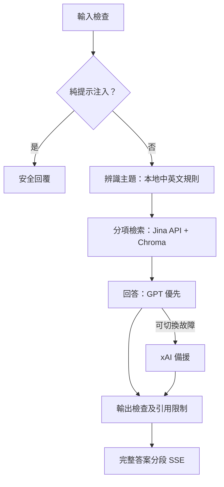

# 聊天圖與供應商備援

本版保留 LangGraph，使用三個節點處理文件問答。

檢索直接執行，不使用 LLM 路由或 ReAct 工具循環。回答一般只呼叫一次聊天模型。原本 workflow 不在 Web 執行路徑，沒有任務或會面寫入工具。

`agent/providers.py` 負責 Responses API、供應商專屬 Key／標頭、請求時間與輸出限制，以及程序內的冷卻機制。GPT 正常不會呼叫 xAI；可切換錯誤後冷卻 60 秒，下一個問題才探測恢復；內容安全拒絕不切換。

`agent/multi_agent.py` 負責三節點圖、最多十則／12,000 字元歷史、參考文件隔離及來源限制。`shared/topics.py` 從實際章節及同義詞辨識主題；`shared/rag.py` 將未快取的主題查詢批次 embedding，再分項檢索及合併。主題辨識不呼叫 LLM。答案引用使用中文文件名稱，API 仍以白名單檔名讀取原文。`agent/onboarding_agent.py` 保留離線工具使用的入口名稱，但不再處理入職工作流程。

為避免主服務半段答案混入備援答案，本版先完成上游回答及輸出檢查，再發送 `citations`、`token`、`done`。前端把串流未收到 `done` 視為中斷，不能當作完整成功。

完整規則見 [規格](specs/chat-document-demo.md)，安全邊界見 [SECURITY](SECURITY.md)。
