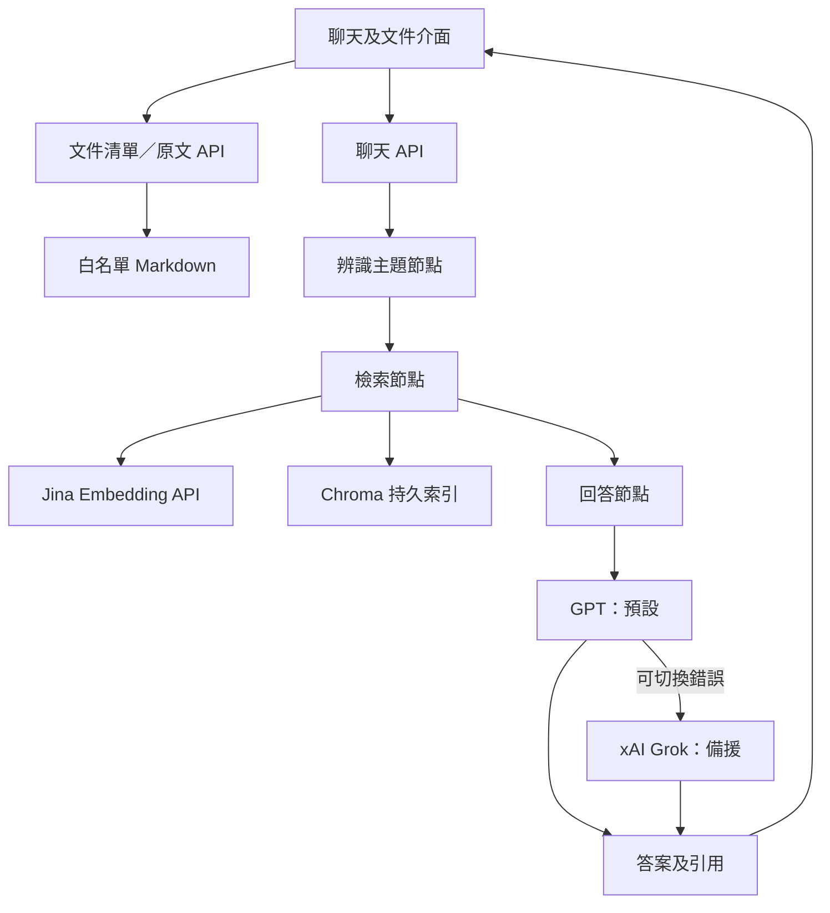

# 聊天與文件閱讀 Demo 規格

日期：2026-11-24（香港時間）
狀態：已實作並完成本機驗證（容器建置未執行）
工作分支：`codex/xai-api`

實際驗證結果及限制見 [VALIDATION](../VALIDATION.md)。

## 1. 目標與範圍

將現有入職系統縮減為香港繁體中文的聊天及文件閱讀 Demo：

1. 預設使用之前的 GPT API；GPT 服務不可用時，自動切換至 xAI Grok。
2. 使用已實測可用的 Jina embedding API，移除本地 E5 模型運算。
3. 保留文件問答、來源引用及原文閱讀；移除入職任務和會面功能對產品及啟動流程的依賴。
4. 後端可以在沒有 PostgreSQL 的環境啟動及完成聊天。
5. 減少模型呼叫、容器依賴及背景流量，方便使用低成本、可休眠的託管環境。

本版不包含員工帳戶、任務建立／完成、入職進度、會面安排、管理員頁面、文件上傳、PDF／Word 解析，以及聊天紀錄的伺服器端持久保存。公司名稱及現有香港政策內容沿用目前版本。

## 2. 現況與已驗證事項

| 項目 | 現況 |
| --- | --- |
| 聊天 | `backend/agent/multi_agent.py` 的 `create_llm()` 只有一組 `OPENAI_*` 設定；沒有跨供應商備援 |
| Agent | LangGraph 串接 orchestrator、research、workflow、synthesizer；同一回合可能有多次聊天模型呼叫 |
| 文件搜尋 | `shared/rag.py` 載入 `intfloat/multilingual-e5-small`，由 SentenceTransformers／PyTorch 在 CPU 產生向量 |
| 向量保存 | Chroma，舊 collection 為 `hr_handbook_multilingual_e5_small_v1` |
| PostgreSQL | `backend/app/main.py` 啟動時執行 `init_db()`；前端開頁和每次回答後也會查詢任務進度 |
| 文件閱讀 | 已有白名單文件 API 及 `SourceDocument` 元件 |
| xAI | `grok-4.3` 聊天 API 實測成功；作為 embedding 模型被 API 明確拒絕 |
| Jina | `jina-embeddings-v4` 實測成功，返回 2048 維向量；簡單中英文語意匹配通過 |

現有 Jina 測試只確認供應商 API 可用，尚未完成應用程式整合或正式 RAG 品質驗收。先前 GPT 使用 `https://share.transmd.cloud/v1` 和 `gpt-6.1-sol`；此處的 GPT 預設指這組設定，而非自動改用 OpenAI 官方端點。

## 3. 使用者體驗

### 3.1 聊天

- 開頁即可輸入問題，不需先取得示範員工資料或任務進度。
- 預設使用香港繁體中文，亦可回應英文問題。
- 保留送出、回答中狀態、Markdown 答案、來源引用、深淺色模式。
- 首頁建議問題只包含公司、福利、政策及文件內容查詢；移除建立待辦或安排會面的建議。
- 使用者要求建立任務或安排會面時，清楚說明本版只提供諮詢及文件閱讀，不宣稱已執行動作。
- GPT 切換至 xAI 時保留同一問題、歷史及搜尋結果，無需使用者重新送出。
- 一個回合只顯示一份最終答案，不混合兩個供應商的答案。
- 歷史保留在目前頁面的記憶體；打開文件再返回聊天不能清除歷史或輸入草稿。重新整理後不保證保留。
- 「清除對話」只清除前端狀態，不呼叫任務重設或資料庫 API。

### 3.2 文件閱讀

- 提供可直接開啟的文件清單，不必先發問取得引用。
- 答案引用可點擊，開啟對應原文；文件清單和引用使用同一個閱讀元件。
- 初期只提供四份既有 Markdown：`employee-handbook.md`、`benefits-guide.md`、`it-setup.md`、`onboarding-checklist.md`。
- 文件閱讀不能依賴 GPT、xAI、Jina、Chroma 索引完成或 PostgreSQL 連線。
- 保留檔名白名單、路徑限制及 Markdown 安全呈現；不存在的文件返回 404。
- 桌面和手機均可關閉閱讀介面並返回原聊天位置。

### 3.3 介面縮減

移除入職進度、任務清單、任務完成按鈕、員工個人資料區、跟進會面及評估結果導覽。`/admin/checkins`、`/admin/evals` 不再提供頁面或在背景載入。評估可保留為開發者離線工具。

供應商網址、Key、備援錯誤及內部工具參數不出現在一般使用者介面。使用者只需看到「辨識主題」、「搜尋文件」、「準備回答」及適當的失敗訊息。

## 4. 目標架構



保留 LangGraph，正常執行路徑為「辨識主題 → 檢索 → 回答」。主題從文件二級標題及中英文同義詞以本地規則辨識；檢索直接執行文件搜尋，不透過聊天模型決定是否搜尋或呼叫工具。不另外呼叫 orchestrator、research LLM 或 synthesizer LLM。

正常回合最多一次問題 embedding API 呼叫及一次聊天模型呼叫；首次建索引、快取未命中、明確重試及聊天備援另計。簡單問候可用確定性的本地規則處理，不增加 LLM 路由呼叫。後續代詞問題可把最近一輪對話加入有長度上限的檢索文字，不新增問題改寫 LLM。

## 5. GPT 優先與 xAI 備援

### 5.1 供應商設定

| 用途 | 預設模型 | 端點 |
| --- | --- | --- |
| GPT 主服務 | `gpt-6.1-sol` | `https://share.transmd.cloud/v1` |
| xAI 備援 | `grok-4.3` | `https://api.x.ai/v1` |

兩組 Key、模型及端點分開讀取。兩者沿用 Responses API；不攜帶前一次回覆的供應商專屬 response ID。僅 GPT 客戶端可使用現有 `x-openai-actor-authorization` 標頭，xAI 不可繼承它。兩者都設定 `store=False`。

### 5.2 切換規則

| 主服務結果 | 行為 |
| --- | --- |
| 成功，且有有效答案 | 使用 GPT，完全不呼叫 xAI |
| 連線／TLS／DNS 錯誤、逾時、HTTP 408、429、5xx | 自動嘗試 xAI |
| 主服務未填 Key、確認為認證／帳戶權限的 HTTP 401／403、模型或端點不存在的 404 | 記錄設定／權限錯誤，嘗試 xAI |
| 完成回應但沒有可用文字、供應商回傳格式損壞 | 視為供應商失敗，嘗試 xAI |
| 使用者輸入驗證失敗、內容安全拒絕（包括安全政策類 403）、一般 HTTP 400／422 | 不透過另一供應商重試；返回相應結果 |
| xAI 也失敗或未設定 | 結束本回合，顯示可重試的友善錯誤 |

主服務及備援每回合各最多一次嘗試，關閉 SDK 隱含重試，避免重複計費及長時間等待。`CHAT_TIMEOUT_SECONDS` 預設 30 秒，需約束整個供應商嘗試的時間，而非只有單次 socket read；連線上限 5 秒。兩個供應商共用 `CHAT_MAX_OUTPUT_TOKENS`（預設 1,200），限制每次生成長度及成本；若供應商回傳未完成／截斷狀態，不當作完整答案或自動再生成一次。

GPT 出現可切換錯誤後，該後端程序進入預設 60 秒冷卻期。期間新回合可直接使用 xAI，避免每次先等待已失效的 GPT。冷卻結束後，下一個使用者回合允許一次 GPT 探測；並行回合最多一個探測，其餘仍用 xAI。GPT 成功後恢復優先使用；再次失敗則重新冷卻。冷卻狀態只保留在程序記憶體，重啟後重新嘗試 GPT，不建立背景探測工作。

使用者取消請求後，不再啟動備援嘗試；關閉未完成的上游請求。

### 5.3 SSE 及錯誤處理

本版沿用現有「先取得完整答案，再以 SSE 分段傳送」的語意，讓備援在答案呈現前完成。備援失敗時不輸出主服務的半份答案。若日後改為上游即時串流，需另行定義已輸出文字後的失敗處理。

保留 `token`、`citations`、`done`、`error` 事件契約；進度可使用精簡的狀態事件。前端遇到 `error`、網路中斷或串流提早結束時，必須結束等待狀態，且不把失敗當成成功的空白答案。`done` 只能發出一次。

## 6. Embedding API 與文件檢索

### 6.1 供應商及向量

- 使用獨立 Jina Key，端點為 `https://api.jina.ai/v1/embeddings`，模型 `jina-embeddings-v4`。
- 文件使用 `task=retrieval.passage`；問題使用 `task=retrieval.query`。
- 明確要求單一 dense float 向量及 2048 維；禁用多向量輸出。依供應商支援的請求格式實作，不套用 E5 的文字前綴。
- 檢查回傳數量、排序 index、向量維度、數值有效性及非零長度；使用一致的 L2 正規化及 cosine 相似度。
- 呼叫逾時預設 60 秒，連線上限 5 秒；連線錯誤、429 或暫時性 5xx 最多額外重試一次，退避及請求仍須受同一個總時間預算約束。驗證／權限／格式錯誤不重試。
- 問題 embedding 失敗時返回「暫時未能搜尋文件」，保持原文閱讀可用。不得靜默下載 E5、改用聊天模型生成數字或以無根據答案替代文件搜尋。
- xAI 聊天備援與 Jina embedding 是獨立故障範圍；GPT 轉 xAI 不能修復 Jina 錯誤。

Jina 官方目前將 v4 API 提供作免費研究／非商業使用，並有限流及速度限制。本規格以非商業 Demo 為前提；正式商業用途應更換合適模型及方案。這不保證未來永遠免費。

### 6.2 Chroma 與索引更新

- 保留 Chroma，直接提供 Jina 產生的向量，明確停用 Chroma 自動 embedding，避免下載另一個本地模型。
- 移除正常執行環境中的 E5、SentenceTransformers 及 PyTorch 依賴。
- 使用新 collection，不能重用 E5 的 384 維索引或將新舊向量混合。
- 保存索引 manifest：供應商、端點識別、模型、維度、task、正規化方式、chunking 版本，以及每份白名單文件的內容雜湊。不得把 Key 納入 manifest。
- 只索引與閱讀介面相同的白名單文件，先沿用目前按標題分段、約 500 字元切塊的規則，保留來源檔名及章節標題。
- 首次搜尋時才建立索引；既有有效索引重啟後直接使用，不能因休眠喚醒而重算所有文件向量。
- 文件變更時只重新 embedding 新增／修改的區塊，刪除已移除的區塊；embedding 模型、維度或 chunking 規則變更則完整重建新索引。
- 建索引需有單一建置鎖、暫存狀態及原子切換。並行首次請求不能重複向 Jina 提交整份知識庫；失敗不得把半成品標記為有效。
- 索引失效且重建失敗時，返回可重試錯誤，不沿用已過期政策回答。
- 查詢向量使用程序內有上限的 LRU 快取（最多 128 筆）；鍵包含檢索文字及 embedding 設定識別。不得為快取引入 PostgreSQL 或 Redis。
- 單一或未辨識主題保留原問題 top-3 語意搜尋；多主題以文件及章節 metadata 分項搜尋，每項最多兩個區塊，先各取一個再補充，合計最多六個。超過六個主題請使用者分開提問。未快取的集中搜尋文字放在同一個 embedding API 請求。完整清單及限制見 [文件主題](../TOPICS.md)。
- 沒有足夠資料時，只能表明「本次找到的片段未包含」該資訊，不能斷言完整文件未記載。相似度門檻不能直接沿用 E5 的分數門檻。

### 6.3 引用及歷史

最終答案只可引用本回合實際檢索到的白名單來源，顯示「僱員手冊」等中文標題；讀取原文的內部檔名保持不變。不能接受模型虛構的檔名。文件及聊天歷史作為資料傳入，不可覆蓋系統安全規則。保留現有輸入長度驗證、prompt injection 防護及輸出檢查。

聊天模型最多接收最近 10 則歷史訊息，另設合計 12,000 字元上限；由最舊訊息開始裁剪。不得加入其他訪客的歷史。主服務和備援使用相同裁剪後的內容。

## 7. 環境變數

更新 `.env.example` 為以下用途；所有 Key 留空，保留適量繁體中文註解：

```dotenv
# GPT：預設，沿用之前的代理設定
OPENAI_API_KEY=
OPENAI_BASE_URL=https://share.transmd.cloud/v1
OPENAI_MODEL=gpt-6.1-sol
OPENAI_ACTOR_AUTHORIZATION=local-image-extension

# xAI：GPT 不可用時的備援
XAI_API_KEY=
XAI_BASE_URL=https://api.x.ai/v1
XAI_MODEL=grok-4.3
CHAT_TIMEOUT_SECONDS=30
CHAT_MAX_OUTPUT_TOKENS=1200
CHAT_FALLBACK_COOLDOWN_SECONDS=60

# Jina：文件及問題向量
EMBEDDING_API_KEY=
EMBEDDING_BASE_URL=https://api.jina.ai/v1
EMBEDDING_MODEL=jina-embeddings-v4
EMBEDDING_DIMENSIONS=2048
EMBEDDING_TIMEOUT_SECONDS=60

# 本機預設使用專案 data/；容器持久磁碟掛載至 /app/data
# DATA_DIR=/app/data
CORS_ORIGINS=http://localhost:5173

# 前端單獨部署時填入公開 HTTPS 後端網址；本機可沿用 Vite proxy
VITE_API_URL=
```

移除預設啟動所需的 `DATABASE_URL`、`POSTGRES_*`、`PGADMIN_*`，不再要求填寫。沒有聊天或 embedding Key 時，後端仍可啟動及提供文件閱讀；相應功能回傳清晰的設定錯誤，不能在 import 時崩潰。

遷移本機 `.env` 時，現有放在 `OPENAI_*` 的 xAI Key 需安全搬至 `XAI_*`，再還原 GPT 端點及模型。舊 GPT Key 如未保留，必須由使用者填回；不能把 xAI Key 複製給 GPT 代理。不要覆蓋 Jina Key、顯示 Key 或將 `.env` 加入 Git。同名變數只能有一份。

## 8. API 及儲存依賴

| API | 本版行為 |
| --- | --- |
| `GET /health` | 輕量程序存活檢查；不查 DB、不呼叫模型、不觸發索引建立 |
| `GET /api/documents` | 新增白名單文件的檔名及顯示標題清單 |
| `GET /api/documents/{filename}` | 保留原文閱讀 |
| `POST /api/chat` | 保留非串流呼叫，共用相同檢索及備援服務 |
| `POST /api/chat/stream` | 保留 SSE 呼叫 |
| 入職任務、會面、評估及員工示範 API | 從本版應用程式路由移除；前端不再呼叫 |

聊天請求使用 `message` 和 `history`，不再要求 `employee_id`。過渡期間可容忍舊客戶端附帶的 `employee_id`，但不讀寫對應資料。

移除 `lifespan` 中的 `init_db()` 及聊天路徑對 `shared.tasks`／`shared.db` 的 import。啟動、讀文件、問政策、清除對話時均不能連接 PostgreSQL。既有本機資料庫及其資料不刪除，也不作資料遷移。

## 9. 部署及成本要求

- 預設 Docker Compose 只啟動前端及後端，移除對 PostgreSQL、pgAdmin、MCP server 和線上評估的啟動依賴。
- 一個後端程序、單一持久目錄保存 Chroma 與 manifest；本版不支援多副本同時寫入本地索引。
- 後端映像不安裝 PyTorch／SentenceTransformers，也不預載 E5；清查 Chroma 預設 embedding、遙測和其他傳遞依賴。
- 支援容器平台提供的 `PORT`、持久 `DATA_DIR` 及前端 HTTPS 來源的 CORS 設定。
- 保持前端沒有輪詢／keep-alive；後端不排程模型健康探測、索引輪詢或資料庫心跳。關閉不必要的定期遙測。
- 更新 README 及啟動說明，區分本機與容器部署；說明索引持久化、文件更新及 API Key 配置。
- 量度容器啟動、索引完成後閒置、一次中英文問答及並行兩回合的 RAM／CPU 峰值；512 MB 只作可嘗試的部署目標，未量度前不宣稱保證可用。
- 記錄每回合使用的聊天供應商、備援原因類別、耗時，以及供應商返回的 token 用量。日誌不包含 Key、授權標頭或完整文件／對話內容。
- Railway 成本與 GPT／xAI／Jina API 成本分別計算；不保證可永久維持於免費額度。

## 10. 實作影響範圍

| 位置 | 預期修改 |
| --- | --- |
| `shared/config.py` | 分離 GPT、xAI、embedding、資料目錄及 CORS 設定 |
| `backend/agent/` | 新增共用的聊天供應商備援層；簡化 LangGraph；保留安全檢查 |
| `shared/rag.py` | 改為 Jina API、向量快取、新 collection 及可更新索引 |
| `shared/documents.py` | 共用白名單、顯示標題及文件清單 |
| `backend/app/main.py` | 移除 DB 初始化及工作流程路由，新增文件清單 API |
| `frontend/src/pages/ChatPage.tsx` | 移除員工／任務狀態依賴，新增文件清單及本機清除對話 |
| `frontend/src/App.tsx`、`api.ts` | 移除管理頁及工作流程 API；保留聊天和閱讀狀態 |
| requirements、Dockerfile、Compose | 移除預設執行環境的本地模型及 PostgreSQL 需求 |
| `.env.example`、README、`docs/RUN.md` | 雙聊天供應商、Jina、無 DB 啟動及部署說明 |
| `tests/`、前端測試、`evals/` | 更新為聊天、文件、故障切換及 API RAG 驗證；淘汰不屬於本版的任務／會面驗收 |

## 11. 驗收條件

### A. 聊天備援

1. GPT 成功：只呼叫 GPT，xAI 呼叫數為零。
2. 模擬 GPT 逾時、429、503、401、模型 404：各自可切換至 xAI，保留同一問題、歷史及引用。
3. GPT 冷卻期內不重複探測；到期恢復一次探測，成功後重新以 GPT 為預設；並行請求不造成大量探測。
4. 輸入驗證失敗或安全拒絕：不以 xAI 繞過限制。
5. 兩個供應商均失敗：SSE 有單一錯誤結果，前端停止等待，保留使用者問題並允許再次送出。
6. 非串流和 SSE 共用相同規則；取消請求不啟動額外備援；不出現重複／混合答案。

### B. 文件及 RAG

7. Jina 文件與問題採用正確 task，返回向量維度一致；拒絕缺少向量、非有限數值、維度錯誤或零向量。
8. 用至少三個中文、三個英文政策問題驗證預期來源出現在 top 3；包含跨語言內容及無關文件作干擾。
9. 答案引用均可開啟對應文件；資料不足時不虛構政策或來源。
10. 第二次啟動及休眠後重啟可重用索引，不再次 embedding 全部文件；修改／刪除文件後索引及答案相應更新。
11. 並行首次檢索只建一次索引；建置失敗不產生有效的半成品，也不回傳已過期政策。
12. Jina 不可用或所有 API Key 未設定時，文件清單及原文仍可閱讀。

### C. 無資料庫及精簡介面

13. 在沒有 `DATABASE_URL`、PostgreSQL、Torch、SentenceTransformers 的乾淨環境啟動，文件閱讀及配置完成後的問答均成功。
14. 開頁、發問及清除對話不發出入職進度、任務、員工或管理頁 API 請求。
15. 介面只有聊天和文件閱讀，沒有建立待辦建議、進度百分比、會面及評估導覽；清除對話不修改伺服器資料。
16. 桌面及手機可從文件閱讀返回原聊天；輸入草稿、答案和引用保留。
17. 路徑穿越、非白名單文件和既有 prompt injection 測試持續通過。

### D. 成本及部署驗證

18. 正常穩態回合符合一次 query embedding 加一次聊天模型呼叫的預算；快取命中則省去 query embedding。
19. 容器映像及程序不載入本地 embedding 模型；記錄 RAM／CPU 實測與索引磁碟大小，不以模型檔案大小代替 RAM 測量。
20. 模擬故障的自動測試不呼叫真實 API；另以明確啟用的少量真實 API smoke test 驗證 GPT、xAI、Jina。GPT 真實測試需先有有效的舊供應商 Key。
21. 若部署 Railway，利用平台狀態及 Metrics／Usage 觀察閒置休眠與費用，不能用定時 `/health` 請求驗證休眠。

## 12. 建議實作次序

1. 雙供應商設定及備援服務，先用模擬失敗驗證切換。
2. Jina embedding、持久索引及文件搜尋整合。
3. 精簡 LangGraph、移除應用程式的 PostgreSQL 依賴。
4. 前端縮減為聊天及文件閱讀，更新 API／SSE 契約。
5. 清理執行依賴、Docker、Compose、環境變數及說明文件。
6. 完成自動測試、真實 API 小量驗證及資源量測，再評估部署方案。

## 13. 參考

- [xAI：OpenAI 相容客戶端與 Responses API](https://docs.x.ai/developers/quickstart)
- [Jina：Embedding API、retrieval task 及輸出格式](https://docs.jina.ai/api.md)
- [Jina：v4 免費 API 與非商業用途限制](https://jina.ai/embeddings/)
- [Railway：休眠條件與背景流量](https://docs.railway.com/deployments/serverless)
- [Railway：用量與費用預測](https://docs.railway.com/projects/project-usage)
